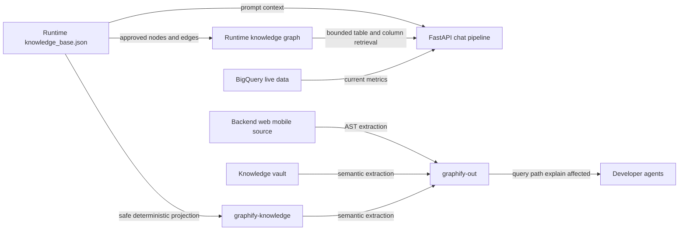

# ADR: Graphify is a development knowledge index

Graphify accelerates codebase navigation and impact analysis. It does not participate in the
production chat path and is not a source for live telco metrics.

## Context

The project has four knowledge planes with different freshness and authority:

1. `backend/data/knowledge_base.json` supplies runtime prompt facts and BigQuery schemas.
2. `vault/` stores durable rationale, decisions, domain rules, and operating conventions.
3. `graphify-out/` stores a derived graph of code and curated documentation for developers.
4. `backend/data/runtime_knowledge_graph.json` is a bounded executable graph compiled only from
   approved runtime KB metadata. It supports production retrieval but never supplies live KPI facts.

The runtime KB is ignored by Git with the rest of `backend/data/`. Scanning that directory would
also expose databases, backups, and runtime files. `graphify-knowledge/` therefore provides a
safe, deterministic projection of approved KB metadata.

## Decision

- The runtime KB remains authoritative for chat behavior. See [[knowledge-base-single-source]].
- The generated projection includes schema names, types, relationships, approved key facts, and
  allowlisted global facts. It excludes prompts, credentials, row samples, and live values.
- FastAPI, Next.js, and Flutter must not import Graphify or read `graphify-out/` at runtime.
- Graphify query feedback and memory remain developer-local and never feed runtime prompts.
- The runtime graph shares stable node and edge concepts with Graphify but is compiled separately.
- Rejected and quarantined objects live in a negative policy index and can never become candidates.
- Successful chat queries may only propose or strengthen existing term-to-table routing edges.
  They cannot create facts, tables, columns, joins, formulas, or approval decisions.

## Freshness lanes

- Code change: run `graphify update .` for a deterministic AST refresh.
- KB change: run `backend/venv/bin/python tools_graphify_kb.py`, then `--check`, then perform a
  semantic Graphify refresh because generated Markdown changed.
- Vault or instruction change: perform a semantic Graphify refresh.
- Commit hooks may keep code topology fresh, but they do not replace semantic document refresh.

## Corpus boundary

`.graphifyignore` excludes secrets, databases, runtime data, build output, large geodata, test
results, historical transcripts, Graphify output, and duplicated Graphify tool documentation.
Never bypass that boundary with a broad `--no-gitignore` scan.

## Recovery

- Missing graph: build from the curated root corpus before using graph results.
- Stale generated projection: run `tools_graphify_kb.py`, then repeat semantic refresh.
- Broad or truncated query: narrow the question or use `explain`, `path`, or `affected`.
- Graph result conflicts with runtime behavior: inspect the targeted source and treat source plus
  runtime KB as authoritative.

## Related

- [[agent-protocol]]
- [[knowledge-base-json]]
- [[knowledge-base-single-source]]
- [[system-overview]]
- [[deploy-restart]]
